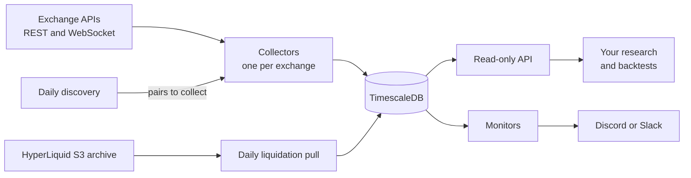
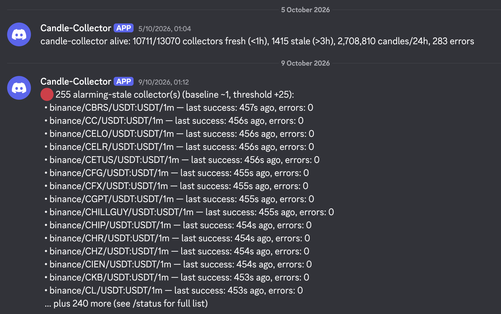

# crypto-data-warehouse

[](https://github.com/holarchic/crypto-data-warehouse/actions/workflows/ci.yml)
[](https://github.com/holarchic/crypto-data-warehouse/releases)
[](LICENSE)

Self-hosted crypto data warehouse: OHLCV, funding rate, open interest, liquidations. Binance, Bybit, HyperLiquid, OKX.

> **Status:** running in production since April 2026, collecting about 700 assets. Pre-1.0: the schema may change between releases.

```console
$ curl "localhost:8000/candles?exchange=binance&asset_id=BTC&timeframe=5m&limit=1"
[
  {
    "exchange": "binance",
    "market_type": "perp",
    "asset_id": "BTC",
    "symbol": "BTC/USDT:USDT",
    "native_symbol": "BTCUSDT",
    "timeframe": "5m",
    "timestamp": "2026-10-13T19:10:00+00:00",
    "open": 83213.9,
    "high": 83238.7,
    "low": 83157.4,
    "close": 83157.4,
    "volume": 100.932,
    "quote_volume": null,
    "trades": null
  }
]
```

## Why

For anyone who wants crypto derivatives data for research or backtesting without paying a data vendor or babysitting six exchange APIs by hand. I built it for my own backtests.

Public endpoints only, so no exchange API keys. It runs unattended on a server you control and tells you when something breaks.

**When not to use it:**

- You need tick-level trades or order books. Use a paid archive such as [Tardis.dev](https://tardis.dev), or stream them yourself with [cryptofeed](https://github.com/bmoscon/cryptofeed), which handles the connections but leaves storage to you.
- You need years of history on day one. crypto-data-warehouse starts with what each exchange returns in one call (up to 1,000 bars per timeframe) and collects forward. For deep Binance history, use its [bulk files](https://data.binance.vision).
- You need a live feed. Data lands once a bar closes, so trading systems should keep their own real-time connection.

## What it collects

| Exchange | Candles | Funding | Open interest | Liquidations | Also |
|---|---|---|---|---|---|
| Binance (USDT perps) | from 1m | ✓ | ✓ | live stream | premium index, 5m |
| Bybit (perps) | from 1m | ✓ | ✓ | live stream | |
| HyperLiquid (perps) | from 1m | ✓ | ✓ | every event, pulled daily | mark, oracle and premium, every minute |
| OKX (perps) | from 5m | ✓ | ✓ | | |
| dYdX (perps) | from 5m | ✓ | | | |
| Coinbase (spot) | from 5m | | | | |

Timeframes are 1m, 5m, 15m, 30m, 1h, 2h, 4h and 12h, where the exchange offers them.

Every exchange starts with BTC. A daily discovery job adds any asset trading over $1M a day on one of the perp exchanges, collects it everywhere it's listed, and drops it once it has stayed below $500k for a week, so a weekend lull doesn't cut its history (thresholds in `collector/exchanges.yaml`). The reference install is tracking about 650 assets on Binance, 620 on Bybit, 400 on OKX and 170 on HyperLiquid. Coinbase and dYdX are BTC only: discovery covers perps, and ccxt can't list dYdX's tickers.

## Data notes

- **Timestamps** are UTC, at the candle's open.
- **Bars are stored once closed** and never change. HyperLiquid 1m is the exception: it arrives over WebSocket, so the latest bar updates until it closes.
- **Gaps:** short outages backfill on the next poll. `GET /status/gaps` lists any stretch where bars are missing, with the count.
- **HyperLiquid 1m** history only reaches back about 5,000 bars (about 3.5 days), so an older 1m gap there can't be filled.
- **Liquidations:** Binance and Bybit come from live streams, which start when you start collecting and have no history. HyperLiquid's come from its S3 archive, pulled once a day.
- **`quote_volume` and `trades`** are `null` where the exchange doesn't provide them.

Symbols use ccxt format (`BTC/USDT:USDT`); `asset_id` (`BTC`) joins them across exchanges.

## How it works



- **Collectors:** one container per exchange. Each polls on candle boundaries, stays inside the exchange's rate limit, and resumes from its last stored bar after a restart. Writes are idempotent.
- **Storage:** TimescaleDB, compressed after 7 days. Candles are kept for 2 years, everything else for 1 year. 1m candles have their own table, so they can sit on a separate volume.
- **API:** read-only FastAPI, plus a parquet export for bulk pulls.

Module and table detail: [`ARCHITECTURE.md`](ARCHITECTURE.md).

## Monitoring

Set `WEBHOOK_URL` in `.env` to a Discord or Slack webhook and it tells you when something breaks.



- **Collector monitor**, every 5 minutes: alerts when a feed goes stale, when a gap appears, and when the number of failing collectors jumps above its recent baseline. Repeats are deduplicated.
- **Host monitor**, every 5 minutes via cron: disk usage at 75%, 85% and 95% per mount, low memory, and stopped containers.
- **Weekly heartbeat:** a summary message, so a silent channel means the alerting itself is down.
- **Dead-man's switch:** set `HEALTHCHECK_PING_URL` (e.g. healthchecks.io) and the monitor pings it every cycle. If the pings stop, that service alerts you.
- **On demand:** `GET /status` shows each collector's last success, error count and staleness.

Thresholds: [`deploy/README.md`](deploy/README.md#monitor-env-vars).

## Requirements

Docker with Compose v2, on anything that runs it, from a VPS to a box at home. No Kubernetes manifests yet (contributions welcome).

Measured on the reference install (4 vCPU, 8 GB RAM, all six exchanges, about 700 assets):

| | |
|---|---|
| Memory | about 2.5 GB across all containers, 1.5 GB of it the database |
| Disk | database about 37 GB after six months; 1m candles add about 2.5 GB a month |
| CPU | near idle, with short bursts at candle boundaries |

It hasn't been tested on less. Start from 4 GB of RAM, and put the database on local SSD, not a network share.

> [!WARNING]
> This is a database. Back it up: `scripts/backup.sh` and `scripts/restore.sh`. To upgrade, follow [Code updates](deploy/README.md#code-updates); don't rerun `deploy/deploy.sh` on a live install, because it can recreate the database.

## Quick start

On a laptop:

```bash
git clone https://github.com/holarchic/crypto-data-warehouse
cd crypto-data-warehouse
cp .env.example .env     # set POSTGRES_PASSWORD
docker compose up -d
```

`curl localhost:8000/health` returns `{"status":"ok"}`. The first 5m candles land within about five minutes; query them with the `curl` at the top of this page. To collect beyond BTC, run discovery: `docker compose --profile discovery run --rm discovery`.

> [!CAUTION]
> This compose file publishes Postgres (5432) and the API (8000) on every interface. On a server, use the production override instead. It keeps Postgres off the network, binds the API to localhost and sets memory limits. [`deploy/README.md`](deploy/README.md) covers provisioning, firewall, cron and updates.

HyperLiquid liquidation history comes from a separate daily job (`--profile liquidations-hl`). It reads a requester-pays S3 bucket, so it needs AWS credentials in `.env`, and AWS bills you for the transfer.

## Install with a coding agent

Paste this into Claude Code, Codex, Cursor or similar:

```text
Install crypto-data-warehouse for me by following
https://raw.githubusercontent.com/holarchic/crypto-data-warehouse/v0.24.1/docs/agent-install.md
Ask me before anything that costs money, opens a public port, or deletes data.
```

The agent will ask whether you want a laptop trial or a server, check prerequisites, write `.env` (asking you for an alert webhook), start the stack, and verify that candles are landing. The full guide is [`docs/agent-install.md`](docs/agent-install.md).

## API

| Endpoint | Returns |
|---|---|
| `GET /candles` | OHLCV, filtered by `exchange`, `asset_id`, `timeframe`, `start`, `end`, `limit` |
| `GET /candles/exchanges` · `/timeframes` · `/symbols` | What's being collected |
| `GET /funding` · `/funding/latest` | Funding rates |
| `GET /oi` · `/oi/latest` | Open interest |
| `GET /liquidations` | Recent liquidations |
| `GET /status` · `/status/gaps` | Collector health and gaps |
| `GET /export/parquet` | HyperLiquid context, Binance open interest or HyperLiquid liquidations for a time window, as parquet |
| `GET /health` | Liveness |

Example queries: [`deploy/README.md`](deploy/README.md#api-queries).

## Configuration

- `collector/exchanges.yaml`: exchanges, timeframes, rate limits, discovery thresholds.
- `.env`: Postgres credentials, alert webhook and thresholds, optional AWS credentials. See `.env.example`.

## Disclaimer

The data is provided as is, without warranty, and may contain gaps or errors. Nothing here is financial advice. You're responsible for following each exchange's terms of service and rate limits.

## Contributing and security

Contributions are welcome: see [`CONTRIBUTING.md`](CONTRIBUTING.md). Report vulnerabilities privately: see [`SECURITY.md`](SECURITY.md).

## Attribution

For those who care about such things, the majority of the code in this repo was produced by Claude Opus 4.8 (Anthropic), with David (@holarchic) guiding Claude, providing insights, direction and critical review throughout the process.

## License

[MIT](LICENSE)
